# My Paint Application
A simple paint program made with Python, Tkinter, and Pillow. The drawing is stored in a Pillow image, so everything you see on the canvas (strokes and shapes) is also saved when you press **Save**.

## REQUIREMENTS COMPLETED

### ✓ Bigger Brush Range
**What I did:** I changed the brush size slider so it can go much thicker. 

**Original code:**

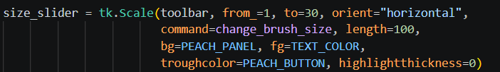

**New code:**

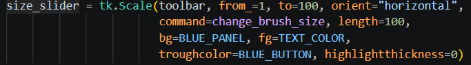

Originally, the maximum brush size was only 30. I changed the `to=` value of the slider to 100 (`from_=1` is still the thinnest).

### ✓ Undo Button
**What I did:** Undo button removes the most recent drawing action, whether it is a freehand stroke or a shape. 

**Original code:**

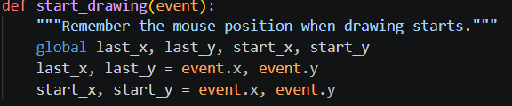

**New code:**

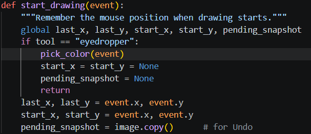
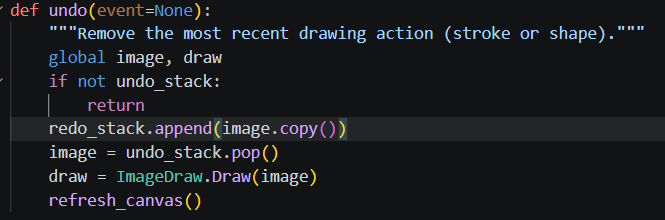

Before every stroke or shape starts, the program saves a copy of the Pillow image (pending_snapshot). When the mouse is released, the copy is pushed onto undo_stack only if the drawing really changed. Pressing Undo puts the last copy back and redraws the canvas. It remembers up to 30 steps (MAX_UNDO).

### ✓ Filled shapes
**What I did:** I added a Fill shapes checkbox. When it is clicked, rectangles, ovals, and the other shapes are filled with the current color.

**Original code:**

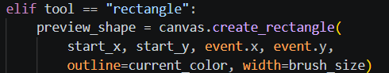

**New code:**

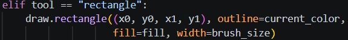

Both the live preview on the canvas and the saved Pillow image follow the checkbox.

### ✓ Extra shape tool (Triangle)
**What I did:** I added a new shape button besides Line, Rectangle, and Oval. It uses a small function that returns the three corner points of the triangle inside the box that the mouse drags.

**Added code:**

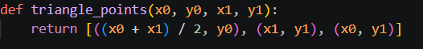

While dragging, the triangle is previewed with create_polygon. When the mouse is released, the same points are drawn on the Pillow image, so the triangle is included in the saved file. It also follows the Fill shapes checkbox.

### ✓ Confirm before clearing
**What I did:** The Clear button now asks "Are you sure you want to clear the drawing?" with Yes and No buttons (messagebox.askyesno).

**Original code:**

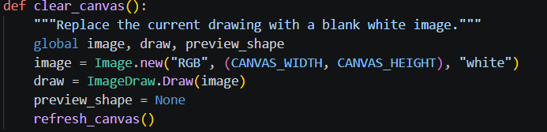

**New code:**

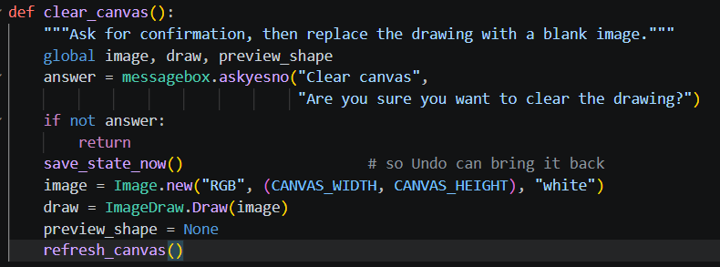

The canvas is cleared only when the answer is Yes. Clearing can also be undone with the Undo button.

### ✓ Quick colors
**What I did:** I added six one-click color buttons: black, red, blue, green, yellow, and indigo.

**Added code:**

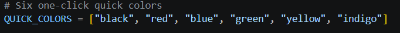
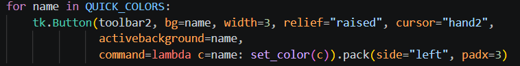

Clicking a button immediately changes the drawing color (and the color of the "Choose Color" button). The buttons are made with a loop over the QUICK_COLORS list.

## ADDITIONAL FEATURES I ADDED
### ✓ Color eyedropper
**What it does:** Click Eyedropper, then click anywhere on the canvas. The program reads the color of that pixel from the Pillow image, makes it the current color, and switches back to the Brush. It also works on shapes and on opened pictures.

**Added code:**

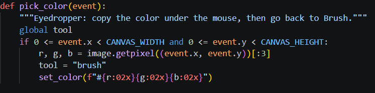

### ✓ Redo button

Brings back the action that was just undone.

### ✓ Keyboard shortcuts

Ctrl+Z for Undo and Ctrl+Y for Redo.

